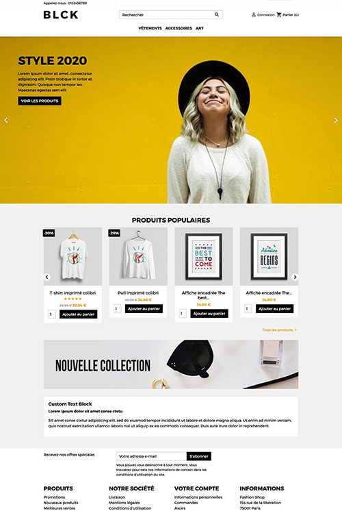

# BLCK - PrestaShop Theme

**A modern, minimal PrestaShop theme with color and font customization, compatible with PrestaShop 1.7, 8 and 9**

[English](#english) | [Français](#français)

Also available: [preview-tablet.png](preview-tablet.png) and [preview-mobile.png](preview-mobile.png).

Current version: 5.0.2 (compatible with PrestaShop 9.2).

---

## English

### About

BLCK is a free PrestaShop theme for stores that want a clean, minimal look and an easy way to change colors, fonts and button styles from the back office, without writing code. Customization is handled by the bundled **BLCK Config** module.

Author: LATOUTFRANCAIS - Arnaud Merigeau - [arnaud-merigeau.fr](https://arnaud-merigeau.fr)

### Features

- Color customization: primary and secondary colors, page background, button styles (including hover) and flag/badge colors
- Social button colors (default and hover), added in 5.0.1
- Font selection for titles and body text, with searchable selectors
- System fonts and Google Fonts (including Bitter, Quicksand, Roboto, Open Sans, and others)
- Responsive layout, with full-width, two-column and three-column options
- Optimized CSS and JavaScript
- Ready for catalog, cart and checkout with standard PrestaShop e-commerce templates

### Compatibility

- PrestaShop 1.7 (1.7.0.0 to 1.7.8.x)
- PrestaShop 8 (8.0.0 to 8.x)
- PrestaShop 9 (9.0.0 through 9.2)

Requirements: PHP 7.0 or higher (PHP 8.0+ recommended for PrestaShop 8 and 9), a modern browser with JavaScript enabled, about 20 MB of disk space.

### Installation

1. Get the `blck.zip` package of the theme.
2. In the PrestaShop back office, go to Appearance > Themes and choose Add a new theme.
3. Upload `blck.zip`. PrestaShop extracts and installs the theme.
4. Click Use this theme, then check the storefront.

Manual install from a ZIP: upload and extract the theme into `/themes/blck/`, then enable it under Appearance > Themes.

After a version upgrade, clear the PrestaShop cache if the storefront does not refresh.

### BLCK Config module

The **BLCK Config** module is installed with the theme.

1. Go to Modules and Services, search for "BLCK config", and open Configure.
2. Choose a title font and a body font.
3. Set the main, secondary and background colors, primary and secondary button colors (default and hover), and flag colors.
4. Save. The module writes CSS variables to `/modules/blckconfig/blck.css` and loads them on the front office. You may need to clear the cache to see the change.

Default colors:

| Element | Color |
|---|---|
| Main color | #000000 |
| Secondary color | #fba000 |
| Background | #f6f6f6 |
| Primary button background / text | #000000 / #FFFFFF |
| Secondary button background / text | #F6F6F6 / #000000 |
| Flag background / text | #000000 / #FFFFFF |

Settings are stored in the PrestaShop Configuration table. The front office uses the generated CSS variables.

### Changelog

See [CHANGELOG.md](CHANGELOG.md) for 5.0.0, 5.0.1 and 5.0.2 (PrestaShop 9.2 image and supplier fixes, multi-shipment orders, social button colors, Google Fonts, and related fixes).

---

## Français

### À propos

BLCK est un thème PrestaShop gratuit, pensé pour une apparence simple et minimale, avec des couleurs, des polices et des styles de boutons réglables depuis le back-office, sans écrire de code. La personnalisation passe par le module **BLCK Config** fourni avec le thème.

Auteur : LATOUTFRANCAIS - Arnaud Merigeau - [arnaud-merigeau.fr](https://arnaud-merigeau.fr)

### Fonctionnalités

- Personnalisation des couleurs : couleurs principale et secondaire, fond de page, styles de boutons (y compris au survol) et couleurs des drapeaux / badges
- Couleurs des boutons sociaux (état normal et survol), ajoutées en 5.0.1
- Choix des polices pour les titres et le corps de texte, avec des sélecteurs recherchables
- Polices système et Google Fonts (notamment Bitter, Quicksand, Roboto, Open Sans, et d'autres)
- Design responsive, avec des mises en page pleine largeur, 2 colonnes et 3 colonnes
- CSS et JavaScript optimisés
- Modèles e-commerce PrestaShop standards (catalogue, panier, commande)

### Compatibilité

- PrestaShop 1.7 (1.7.0.0 à 1.7.8.x)
- PrestaShop 8 (8.0.0 à 8.x)
- PrestaShop 9 (9.0.0 jusqu'à 9.2)

Prérequis : PHP 7.0 ou plus (PHP 8.0+ recommandé pour PrestaShop 8 et 9), navigateur moderne avec JavaScript, environ 20 Mo d'espace disque.

### Installation

1. Récupérer le fichier `blck.zip` du thème.
2. Dans le back-office PrestaShop, aller dans Apparence > Thèmes, puis Ajouter un thème.
3. Envoyer `blck.zip`. PrestaShop extrait et installe le thème.
4. Cliquer sur Utiliser ce thème, puis vérifier la boutique.

Installation manuelle : envoyer et extraire le thème dans `/themes/blck/`, puis l'activer dans Apparence > Thèmes.

Après une mise à jour, vider le cache PrestaShop si la boutique ne se rafraîchit pas.

### Module BLCK Config

Le module **BLCK Config** est installé avec le thème.

1. Aller dans Modules et services, chercher "BLCK config", puis ouvrir Configurer.
2. Choisir la police des titres et celle du texte.
3. Régler les couleurs principale, secondaire et de fond, les couleurs des boutons primaires et secondaires (normal et survol), et les couleurs des drapeaux.
4. Enregistrer. Le module écrit des variables CSS dans `/modules/blckconfig/blck.css` et les charge en front-office. Il peut être nécessaire de vider le cache.

Couleurs par défaut : voir le tableau dans la section anglaise ci-dessus.

### Journal des modifications

Voir [CHANGELOG.md](CHANGELOG.md) pour les versions 5.0.0, 5.0.1 et 5.0.2.

---

## License

This theme is provided as-is for use with PrestaShop. Please refer to the license files included in the theme directory for more information.

Ce theme est fourni tel quel pour une utilisation avec PrestaShop. Veuillez consulter les fichiers de licence inclus dans le repertoire du theme pour plus d'informations.

## Support

LATOUTFRANCAIS - Arnaud Merigeau

- Site: [arnaud-merigeau.fr](https://arnaud-merigeau.fr)
- Email: [contact@arnaud-merigeau.fr](mailto:contact@arnaud-merigeau.fr)
